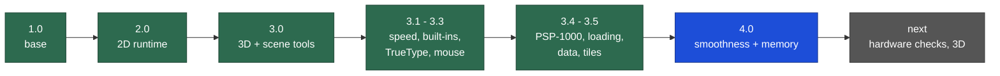

# VCPE: Vain's C Portable Engine

A game engine in plain C for the **Sony PlayStation Portable**, built for demakes: PC games rewritten to run on the
PSP's 333 MHz CPU, its GE graphics chip and its 32 or 64 MB of memory.

VCPE has no splash screen and no scripting requirement. A game links only the modules it uses.

## Progress map

Green: released. Blue: the current version, on `main`. Grey: planned.

| Version | Source | What it added |
|---|---|---|
| **1.0** | [Release](https://github.com/surelynotvain/vcpe/releases/tag/vcpe-1.0) | System callbacks, data PAK, GU renderer, ADPCM mixer, autotest harness, converter tools |
| **2.0** | [Release](https://github.com/surelynotvain/vcpe/releases/tag/vcpe-2.0) | A Unity-style 2D runtime: scenes and prefabs, animator, 2D physics subset, pathfinding, particles, glyph text |
| **3.0** | [Release](https://github.com/surelynotvain/vcpe/releases/tag/vcpe-3.0) | 3D module (depth buffer, camera, indexed meshes, fog), node tree with animation players, coroutines, baked fonts, view culling, post effects without shaders, Godot 4 scene tools, start-up error screen |
| **3.1** | in 3.3 | Faster mixer (bit-identical output), opt-in draw batching and GE pipelining, math tables, pad input, crash-safe saves, log file, HUD text and PSP button icons, perf overlay, start-up checks, self-test EBOOT |
| **3.2** | in 3.3 | `vcpe_ttf`: TrueType/OpenType text rasterized on the PSP, sub-pixel pen positions, kerning, glyph cache |
| **3.3** | [Release](https://github.com/surelynotvain/vcpe/releases/tag/vcpe-3.3) | `vcpe_mouse`: a PC mouse simulated with the analog stick and buttons (warps, drag and drop, wheel) |
| **3.4** | in 3.5 | `vcpe_mem`: PSP-1000 (32 MB) support, the 4 MB volatile partition, texture slabs that can't fragment; `vcpe_load`: the standard loading screen with a boot log |
| **3.5** | [Release](https://github.com/surelynotvain/vcpe/releases/tag/vcpe-3.5) | `vcpe_data`: read-only structured data from converters; `vcpe_tiles`: visible-tile batching for 2D maps |
| **4.0** | [Release](https://github.com/surelynotvain/vcpe/releases/tag/vcpe-4.0), `main` | Text binds its texture once instead of once per string, O(1) sprite cache, pooled coroutine threads, sleep/resume reload behind the loading screen, display-list overflow guard, arenas, vblank and GE timing, one standard perf and memory line |

3.1, 3.2 and 3.4 have no snapshot of their own: they were finished on the way to the next version, and their source
is part of 3.3 and 3.5. [CHANGELOG.md](CHANGELOG.md) describes every version from 3.1 on, and
[docs/upgrading-to-4.0.md](docs/upgrading-to-4.0.md) says what a game can adopt.

### Next
- Check the 4.0 opt-ins on real hardware: lazy texture-cache flushes, a 512-sample audio block, resume after sleep
- 3D: skinned meshes, 16-bit vertex formats, loading parts of a scene behind a black screen
- One naming scheme for the runtime files, and a documented data format in place of game-specific names
- Try `-O3` and link-time optimization against the frame recordings

## How it is tested
- **Frame-exact recordings.** Autotest scripts drive a build in PPSSPP headless with a fixed time step and seed. Every
  engine change is built against several games and compared frame by frame with the previous version.
  Behaviour changes stay opt-in until they draw the same frames.
- **Self-test EBOOT.** One EBOOT exercises every built-in module: the PAK, math, saves, audio, input, mouse,
  memory, loading screen, coroutines and the 4.0 binding cache. It also checks that batched and pipelined
  snapshots match the plain one.
- **Host tests.** Plain-gcc tests for the mixer, math accuracy, saves, input edges and file converters.
- **Hardware.** Audio, sleep/resume and the GE texture cache can't be proven in an emulator, so they are checked on
  a PSP.

## Layout

| Folder | What it is |
|---|---|
| [`src/`](src/) | The engine modules (`vcpe_*.c/.h`); `vcpe.h` includes them all |
| [`runtime/`](runtime/) | The 2D runtime from 2.0 |
| [`tools/`](tools/) | Converters: texture pages, ADPCM sound, PAK writer, fonts, Godot 4 scene helpers, XMB icon/background/sound makers |
| [`docs/`](docs/) | Guides: upgrading, the PSP-1000, input and converters |
| [`engineassets/`](engineassets/) | Source pictures of the error screen and the loading animation (third-party, see the license) |
| [`tests/`](tests/) | Host tests |

A game's Makefile compiles the modules it lists from `src/` (and `runtime/` if it uses it) next to its own code,
with the [pspdev](https://github.com/pspdev/pspdev) toolchain.

## Made with AI, open to people
AI tools were used in the development of VCPE and still are, for writing code, reviewing it and testing it. Every
change is checked against the frame recordings, and what an emulator can't show is checked on a PSP.

**Human contributions are more than welcome:** bug reports, hardware test results (especially PSP-1000 and PSP Go),
fixes, optimizations and docs. Open an issue or a pull request.

## License
VCPE 3.0 and later: the [VCPE Contribute-Back License](LICENSE), by surelynotvain. Use VCPE in any project, free of
charge; if you change the engine, send those changes back as a pull request to this repository, and credit VCPE in
your project. Your game's own code and content stay yours. VCPE 1.0 and 2.0 were released under MIT.
