# VCPE: Vain's C Portable Engine

A game engine in plain C for the **Sony PlayStation Portable**, built for demakes: PC games rewritten to run on the
PSP's 333 MHz CPU, its GE graphics chip and its 32 or 64 MB of memory.

VCPE has no splash screen and no scripting requirement. A game links only the modules it uses.

## Progress map

```mermaid
flowchart LR
    V1["1.0<br/>base"] --> V2["2.0<br/>2D runtime"] --> V3["3.0<br/>3D + scene tools"]
    V3 --> V33["3.1 - 3.3<br/>speed, built-ins,<br/>TrueType, mouse"] --> V35["3.4 - 3.5<br/>PSP-1000, loading,<br/>data, tiles"]
    V35 --> V40["4.0<br/>smoothness + memory"] --> V40X["4.0.x<br/>hardware validation"]
    V40X --> V41["4.1<br/>naming, formats,<br/>open test suite"] --> V5["5.0<br/>skinning, 16-bit verts,<br/>streaming"]
    classDef pub fill:#2d6a4f,color:#fff,stroke:#1b4332
    classDef cur fill:#1d4ed8,color:#fff,stroke:#1e3a8a
    classDef plan fill:#555,color:#fff,stroke:#333
    class V1,V2,V3,V33,V35 pub
    class V40 cur
    class V40X,V41,V5 plan
```

Green: released. Blue: the current version, on `main`. Grey: planned (see the [roadmap](#roadmap)).

| Version | Source | What it added |
|---|---|---|
| **1.0** | [Release](https://github.com/surelynotvain/vcpe/releases/tag/vcpe-1.0) | System callbacks, data PAK, GU renderer, ADPCM mixer, autotest harness, converter tools |
| **2.0** | [Release](https://github.com/surelynotvain/vcpe/releases/tag/vcpe-2.0) | A Unity-style 2D runtime: scenes and prefabs, animator, 2D physics subset, pathfinding, particles, glyph text |
| **3.0** | [Release](https://github.com/surelynotvain/vcpe/releases/tag/vcpe-3.0) | 3D module (depth buffer, camera, indexed meshes, fog), node tree with animation players, coroutines, baked fonts, view culling, post effects without shaders, Godot 4 scene tools, start-up error screen |
| **3.1** | in 3.3 | Faster mixer (bit-identical output), opt-in draw batching and GE pipelining, math tables, pad input, crash-safe saves, log file, HUD text and PSP button icons, perf overlay, start-up checks, self-test EBOOT |
| **3.2** | in 3.3 | `vcpe_ttf`: TrueType/OpenType text rasterized on the PSP, sub-pixel pen positions, kerning, glyph cache |
| **3.3** | [Release](https://github.com/surelynotvain/vcpe/releases/tag/vcpe-3.3) | `vcpe_mouse`: a PC mouse simulated with the analog stick and buttons (warps, drag and drop, wheel) |
| **3.4** | in 3.5 | `vcpe_mem`: PSP-1000 (32 MB) support, the 4 MB volatile partition, texture slabs that can't fragment; `vcpe_load`: the standard loading screen with a boot log |
| **3.5** | [Release](https://github.com/surelynotvain/vcpe/releases/tag/vcpe-3.5) | `vcpe_data`: read-only structured data from converters; `vcpe_tiles`: visible-tile batching for 2D maps |
| **4.0** | [Release](https://github.com/surelynotvain/vcpe/releases/tag/vcpe-4.0), `main` | Text binds its texture once instead of once per string, O(1) sprite cache, pooled coroutine threads, sleep/resume reload behind the loading screen, display-list overflow guard, arenas, vblank and GE timing, one standard perf and memory line |

3.1, 3.2 and 3.4 have no snapshot of their own: they were finished on the way to the next version, and their source
is part of 3.3 and 3.5. [CHANGELOG.md](CHANGELOG.md) describes every version from 3.1 on, and
[docs/upgrading-to-4.0.md](docs/upgrading-to-4.0.md) says what a game can adopt.

## Roadmap

Status: **Done** shipped in a release · **Active** being worked on · **Planned** decided, not started ·
**Exploring** being evaluated, may be dropped.

### Track A: hardware validation of 4.0
Some 4.0 features can't be proven in an emulator (PPSSPP ignores the GE texture cache and does not model sleep).
They stay opt-in until a real console confirms them.

| Item | Status | Exit criterion |
|---|---|---|
| Lazy texture-cache flushes (`vcpe_gfx_lazy_texflush`) | Active | No stale texels in busy scenes on a PSP-2000/3000; fewer GE stalls measured with `vcpe_gfx_bench` |
| 512-sample mixer block (`-DVCPE_AUDIO_FRAMES=512`) | Active | No dropouts or crackle under a CPU-bound update on hardware |
| Volatile-bundle reload after sleep | Active | Ten sleep/resume cycles in a row without missing textures |
| Late-vblank counter on hardware | Planned | `vcpe_stat_vblank_misses` agrees with frame timing measured on a real PSP |
| PSP-1000 and PSP Go runs | Planned | Self-test and a 32 MB scene pass on both models |

### Track B: performance
| Item | Status | Notes |
|---|---|---|
| `-O3`, `-ffunction-sections` / `--gc-sections` | Exploring | Kept only if the recordings stay frame-identical and the EBOOT does not grow |
| Link-time optimization | Exploring | Unproven with `-G0` on the PSP toolchain |
| Display-list sizing per game | Planned | Use `vcpe_stat_dlist_peak_kb` to trim the 512 KB default, mainly on the PSP-1000 |
| Draw-order tie-breaking by page and palette | Exploring | Fewer binds where sprites don't overlap; `vcpe_tiles` already does it for maps |
| VFPU paths for matrix-heavy 3D | Exploring | Only where profiling shows the FPU is the bottleneck |

### Track C: 3D
| Item | Status | Notes |
|---|---|---|
| Skinned meshes | Planned | GE hardware skinning (up to 8 bone weights per vertex) driven by `vcpe_node3d` animation |
| 16-bit vertex formats | Planned | Half the vertex memory and bus traffic for static meshes; converter quantizes with per-mesh bounds |
| Streaming scene areas | Planned | Load and free parts of a scene behind a black screen or the loading screen |
| Hardware lights | Exploring | Next to the baked vertex lighting the Godot tools produce |
| Low-resolution render-to-texture | Exploring | PS1-style looks and cheaper fill rate |

### Track D: engine structure and data
| Item | Status | Notes |
|---|---|---|
| One naming scheme for the 2D runtime | Planned | The 2.0 runtime files get `vcpe_` names, with compatibility headers for one release |
| Documented data formats | Planned | PAK, texture pages, sprite sections, scene ("world") and VDAT formats described byte by byte |
| Module reference | Planned | One page per module: purpose, memory cost, frame cost, threading rules |
| Starter template | Planned | A minimal game: Makefile, `main.c`, PAK build, loading screen, XMB files |

### Track E: testing in the open
| Item | Status | Notes |
|---|---|---|
| Publish the self-test EBOOT | Planned | Every built-in module exercised in one EBOOT, runnable in PPSSPP headless |
| Publish the host tests | Planned | Mixer bit-equivalence, math accuracy, save recovery |
| Game-neutral frame-recording harness | Planned | The record/compare scripts with sample scenarios instead of real games |
| Continuous integration | Exploring | Host tests and a self-test build on every pull request |

### Release plan
- **4.0.x**: fixes, and the Track A results. An opt-in that passes on hardware may become the default in a
  minor release, always with a changelog entry and a recording check.
- **4.1**: Track D naming and documentation, the open test suite (Track E).
- **5.0**: 3D animation and streaming (Track C). Breaking API changes, if any, are only made in a major version
  and come with an upgrade guide in `docs/`.

## How it is tested
- **Frame-exact recordings.** Autotest scripts drive a build in PPSSPP headless with a fixed time step and seed. Every
  engine change is built against several games and compared frame by frame with the previous version.
  Behaviour changes stay opt-in until they draw the same frames.
- **Self-test EBOOT.** One EBOOT exercises every built-in module: the PAK, math, saves, audio, input, mouse,
  memory, loading screen, coroutines and the 4.0 binding cache. It also checks that batched and pipelined
  snapshots match the plain one.
- **Host tests.** Plain-gcc tests for the mixer, math accuracy, saves, input edges and file converters.
- **Hardware.** Audio, sleep/resume and the GE texture cache can't be proven in an emulator, so they are checked on
  a PSP.

## Layout

| Folder | What it is |
|---|---|
| [`src/`](src/) | The engine modules (`vcpe_*.c/.h`); `vcpe.h` includes them all |
| [`runtime/`](runtime/) | The 2D runtime from 2.0 |
| [`tools/`](tools/) | Converters: texture pages, ADPCM sound, PAK writer, fonts, Godot 4 scene helpers, XMB icon/background/sound makers |
| [`docs/`](docs/) | Guides: upgrading, the PSP-1000, input and converters |
| [`engineassets/`](engineassets/) | Source pictures of the error screen and the loading animation (third-party, see the license) |
| [`tests/`](tests/) | Host tests |
| [`LICENSE`](LICENSE), [`AI_POLICY.md`](AI_POLICY.md), [`CONTRIBUTING.md`](CONTRIBUTING.md), [`CHANGELOG.md`](CHANGELOG.md) | Terms, how AI is used, how to contribute, what changed |

A game's Makefile compiles the modules it lists from `src/` (and `runtime/` if it uses it) next to its own code,
with the [pspdev](https://github.com/pspdev/pspdev) toolchain.

## AI use and human contributions

VCPE is developed with AI assistance, and that is disclosed rather than hidden. The full policy is in
[AI_POLICY.md](AI_POLICY.md). In short:

- **What AI does.** AI coding assistants have written and still write a large share of the code, tools, tests and
  documentation, and are used to review changes, analyse performance and search for bugs.
- **What people do.** The maintainer sets the direction, decides what is accepted, runs the hardware tests and is
  responsible for every release. AI tools are not authors or contributors of record: commits and releases are made
  by people.
- **What is checked.** No change is kept on an AI's word. Every engine change has to keep the frame-exact recordings
  identical or explain the difference, pass the self-test and host tests, and anything an emulator can't show
  (audio, sleep, texture cache, real timing) is checked on a PSP before it becomes a default.
- **What can still be wrong.** Tested is not proven: AI-written code can be subtly wrong in paths no test covers.
  Reports of that kind are especially valuable.

**Human contributions are more than welcome**, and they are what this project needs most: hardware test results
(PSP-1000, PSP Go and the Street especially), bug reports with a reproduction, fixes, performance measurements,
documentation and reviews of existing code. Contributions written with AI help are accepted too, under the rules in
[CONTRIBUTING.md](CONTRIBUTING.md): say so, understand what you submit, and test it.

## License

| Versions | License |
|---|---|
| 3.0 and later | [VCPE Contribute-Back License 1.1](LICENSE) |
| 1.0 and 2.0 | MIT (as released) |

What it means in practice (the [LICENSE](LICENSE) text is what counts):

- **Free to use** in any project, commercial or not, including closed-source games.
- **Engine changes go back upstream.** If you distribute anything containing modified VCPE files, you send those
  modifications to this repository as a pull request within 30 days. Changes you never distribute (private
  experiments, internal builds) carry no obligation.
- **Your project stays yours.** A game's own code, art, audio and data are never covered, however they are linked
  with VCPE.
- **Credit VCPE** in your project's credits or readme.
- **Patents:** contributors grant a patent license for their contributions; it ends for anyone who sues over them.
- **Third-party material** (the error-screen and loading pictures in `engineassets/`, toolchain libraries) keeps
  its own terms.

Releases 3.0 to 4.0 shipped with version 1.0 of this license; anyone may choose to use them under 1.1 instead.
